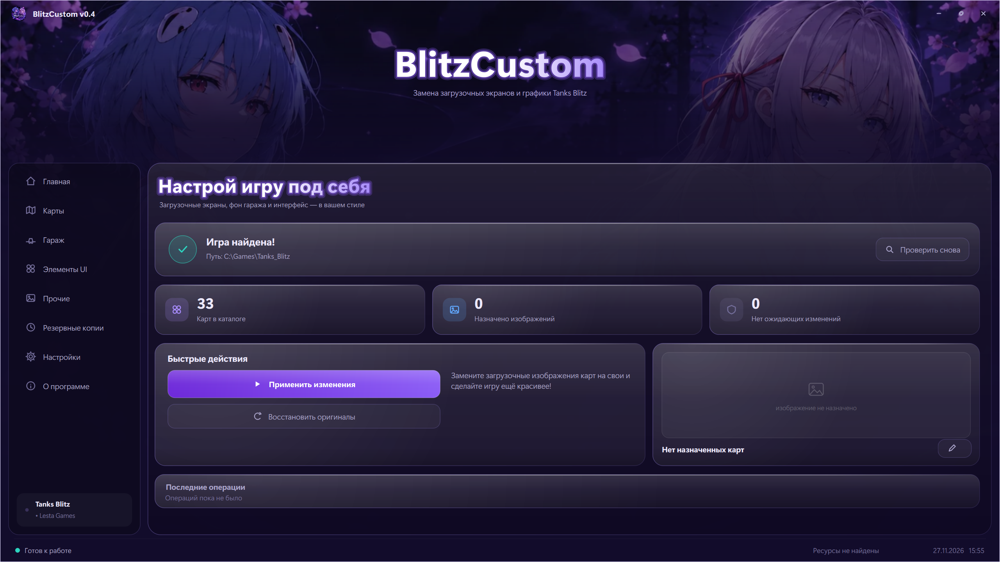
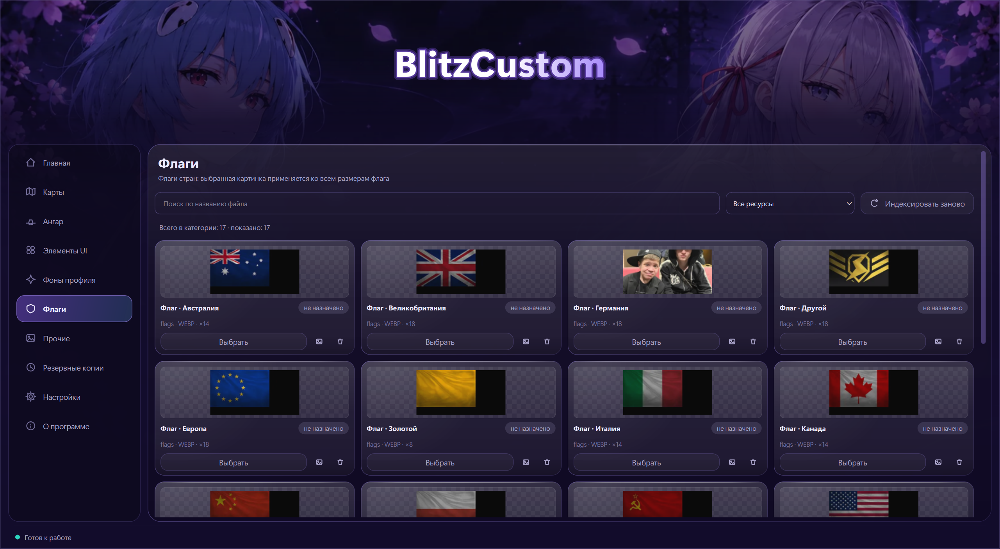
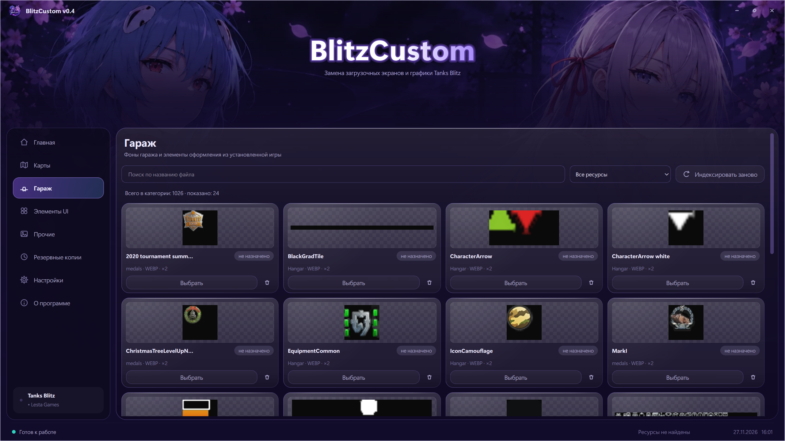
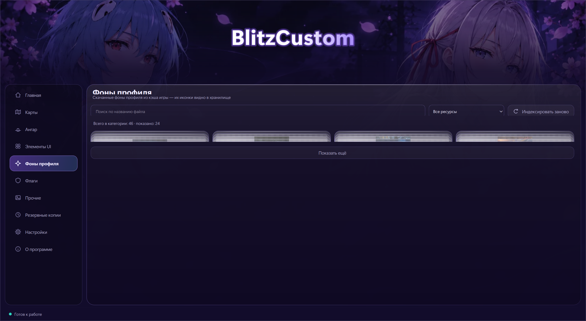
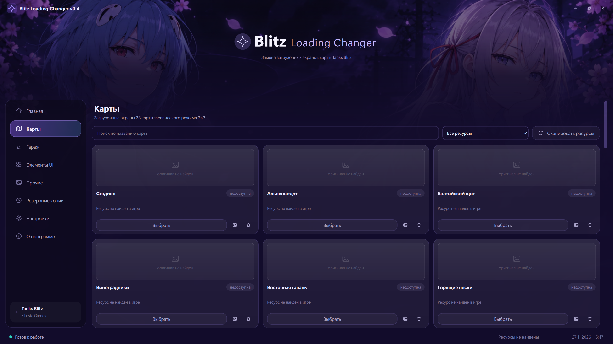

# BlitzCustom v0.4

Приложение для замены загрузочных экранов, фонов гаража, фонов профиля, флагов и графики
интерфейса **Tanks Blitz (Lesta)** на свои изображения. Интерфейс — PySide6, тема
Liquid Glass / Dark Pearl Glass.



## Возможности

- **Карты** — 33 карты классического режима 7×7: назначение, предпросмотр, применение,
  сброс. Заменяются все варианты загрузочного экрана карты.
- **Ангар** — фоны ангара и элементы оформления из установленной игры.
- **Элементы интерфейса** — иконки, кнопки, панели, фоны лобби.
- **Фоны профиля** — фоны, которые игра скачивает в кэш (2048×1536).
- **Флаги** — 17 стран: одна карточка на страну, картинка применяется сразу ко всем
  вариантам флага (карусель, летящий флаг, уведомления, дерево танков, оба размера).
- **Прочие** — всё остальное, что нашлось в кэше.

Общее для всех разделов:

- поиск по имени файла и фильтры (все / назначенные / неназначенные / недоступные);
- **предпросмотр** — сравнение «сейчас в игре» и «будет после замены» с учётом режима
  подгонки и качества;
- **резервные копии** оригиналов и восстановление по одному, по категории или всё сразу;
- плашка «Не забудьте применить изменения» после выбора картинки;
- применение без модальных окон: состояние показывается прямо в панели действий.

## Установка

### Готовый EXE

```
dist\BlitzCustom\BlitzCustom.exe
```

Папку `BlitzCustom` нужно держать целиком (exe + `_internal`). Приложение запускается
**с правами администратора**: фоны профиля и часть ресурсов лежат в «Документах», а
Windows не даёт писать туда обычному процессу (ошибка «Нет прав на запись в папку»).

### Из исходников

```sh
python -m pip install -r requirements.txt
python main.py
```

Или двойным щелчком по `run.bat`.

Сборка EXE:

```bat
build_exe.bat
```

## Безопасность

- Меняются только те ресурсы, для которых известен безопасный способ записи: контейнер
  **DVPL типа 0** с WebP/PNG/JPEG внутри. Сжатые контейнеры (`type 2`, LZ4) и файлы с
  неопознанной нагрузкой не трогаются — их можно только просматривать.
- Перед первой заменой создаётся **резервная копия** оригинала с SHA-256, повторные
  замены её не перезаписывают.
- Запись идёт через временный файл и `os.replace`, после записи результат проверяется
  повторным декодированием; при ошибке изменения откатываются.
- Приложение отказывается работать, если запущена игра.

## Ограничения

- **Аватары** пока не поддерживаются: в игре аватар — составной объект (маска + рамка +
  рисунок), готовыми картинками лежат только «накопительные» значки.
- Неизвестные и зашифрованные контейнеры не изменяются.
- Игра при обновлении может вернуть оригинальные файлы — после обновления стоит нажать
  «Индексировать заново» и при необходимости применить изображения повторно.

## Скриншоты

| Флаги | Ангар |
|---|---|
|  |  |

| Фоны профиля | Карты |
|---|---|
|  |  |

## Устройство проекта

| Файл | Назначение |
|---|---|
| `main.py` | точка входа, режим диагностики `--diagnose` |
| `ui/` | интерфейс на PySide6: окно, страницы, тема, анимации, контроллер |
| `resource_catalog.py` | индекс ресурсов игры и кэша, группировка дублей |
| `resource_scanner.py` | сканирование загрузочных экранов карт |
| `resource_replacer.py` | безопасная замена с проверкой и откатом |
| `image_processor.py` | проверка, подгонка и подготовка изображений |
| `dvpl.py` | чтение и запись контейнеров DVPL |
| `backup_manager.py` | резервные копии и восстановление |
| `game_detector.py` | поиск установленной игры |
| `map_database.py` | каталог 33 карт |
| `settings_manager.py`, `utils.py` | настройки, пути, журналирование |

Пользовательские данные (настройки, резервные копии, свои изображения, журналы) лежат
рядом с программой; если папка недоступна для записи — в `%LOCALAPPDATA%`.

## Совместимость

- Windows 10 / 11, x64
- Tanks Blitz (Lesta), версия 26.12.0 проверена
- Форматы изображений: PNG, JPG/JPEG, WEBP, BMP
